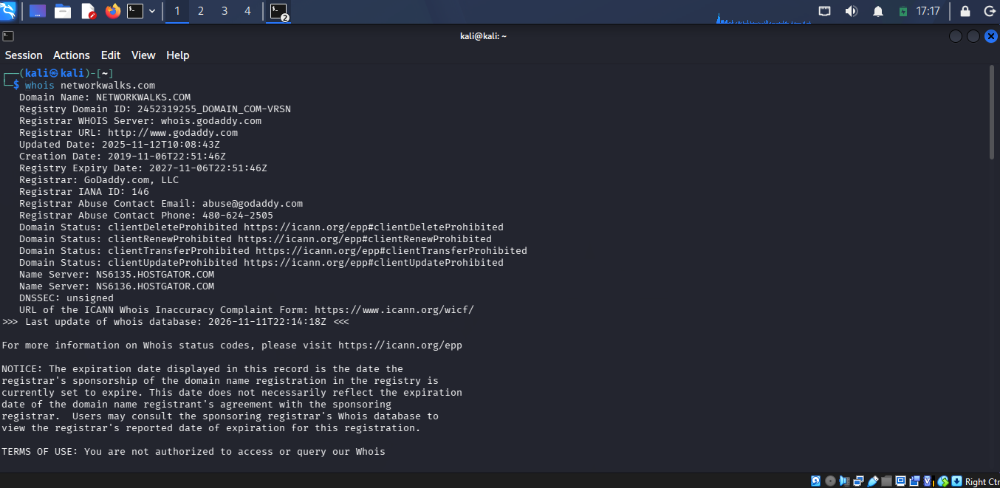
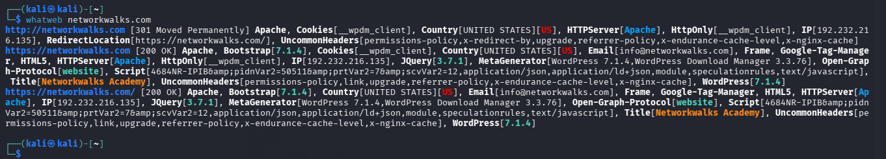
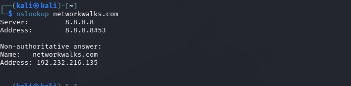
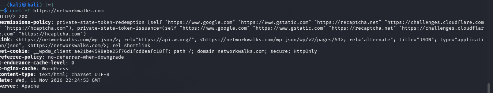
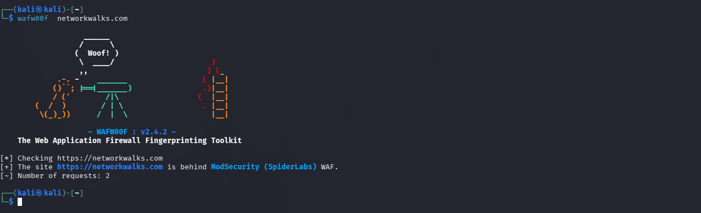

# W2-PM1: Footprinting with Multiple Kali Linux Tools

## 1. Project Overview
This project focuses on using six Kali Linux tools to perform passive and active footprinting and information gathering against authorized target environments (`networkwalks.com`).

---

## 2. Objectives
- Understand the core concepts and methodologies of footprinting.
- Explore and configure selected command-line footprinting tools in Kali Linux.
- Gather actionable technical intelligence within an authorized project scope.
- Analyze, correlate, and document key findings.

---

## 3. Tools Used & Command Syntax

| Tool | Primary Function | Command Syntax Example |
| :--- | :--- | :--- |
| `whois` | Domain registration & contact info | `whois networkwalks.com` |
| `whatweb` | Web technology & CMS identification | `whatweb -a 3 https://networkwalks.com` |
| `nslookup` | DNS record lookup (A, MX, NS, TXT) | `nslookup -type=MX networkwalks.com` |
| `curl` | HTTP header and server response analysis | `curl -I https://networkwalks.com` |
| `wafw00f` | Web Application Firewall (WAF) detection | `wafw00f https://networkwalks.com` |
| `dnsrecon` | Advanced DNS enumeration & zone records | `dnsrecon -d networkwalks.com` |

---

## 4. Practical Exercises

### Tool 1: `whois`
* **Purpose:** Retrieve domain registration details, name servers, and administrative contacts.
* **Availability:** Pre-installed in Kali Linux (`sudo apt install whois`).
* **Command Executed:**
  ```bash
  whois networkwalks.com
Target & Scope: networkwalks.com (Authorized scope)

Results Obtained:

Registrar: GoDaddy.com, LLC (IANA ID: 146)

Dates: Created on 2019-11-06, Expires on 2027-11-06

Registrant Org: Domains By Proxy, LLC (Privacy Protected)

Name Servers: NS6135.HOSTGATOR.COM, NS6136.HOSTGATOR.COM, NS29.DOMAINCONTROL.COM, NS30.DOMAINCONTROL.COM

Screenshots & Evidence:


Observations: The domain uses a privacy protection service (Domains By Proxy) to obscure the real owner's identity. It is hosted via HostGator infrastructure with GoDaddy handling registrar management.

Tool 2: whatweb
Purpose: Identify server technologies, web applications, CMS versions, and HTTP headers.

Availability: Pre-installed in Kali Linux (sudo apt install whatweb).

Command Executed:

Bash
whatweb -a 3 [https://networkwalks.com](https://networkwalks.com)
Target & Scope: https://networkwalks.com (Authorized scope)

Results Obtained:

IP Address: 192.232.216.135 (Country: United States)

Web Server: Apache

CMS Platform: WordPress 7.1.4 along with WordPress Download Manager 3.3.76

Framework & Library: Bootstrap 7.1.4, jQuery 3.7.1, Google Tag Manager

Disclosed Contact: info@networkwalks.com

Screenshots & Evidence:


Observations: The application explicitly exposes its exact WordPress and plugin version numbers, which can be cross-referenced against vulnerability databases for outdated components.

Tool 3: nslookup
Purpose: Query DNS servers directly for IP mappings and records.

Availability: Pre-installed via bind-utils package (sudo apt install dnsutils).

Command Executed:

Bash
nslookup networkwalks.com
Target & Scope: networkwalks.com (Authorized scope)

Results Obtained:

DNS Server Queried: 8.8.8.8 (Google Public DNS)

Resolved A Record (IP): 192.232.216.135

Screenshots & Evidence:


Observations: Confirmed the primary public-facing IPv4 address mapped to the root domain via an external recursive resolver.

Tool 4: curl
Purpose: Fetch HTTP response headers to inspect web server signatures and response codes.

Availability: Pre-installed in Kali Linux (sudo apt install curl).

Command Executed:

Bash
curl -I [https://networkwalks.com](https://networkwalks.com)
Target & Scope: https://networkwalks.com (Authorized scope)

Results Obtained:

HTTP Status Code: HTTP/2 200 OK

Server Header: Apache

Set-Cookie: __wpdm_client=...; path=/; domain=networkwalks.com; secure; HttpOnly

API Link Header: Exposes WordPress REST API route (/wp-json/)

Screenshots & Evidence:


Observations: The cookie correctly implements security flags (secure and HttpOnly), mitigating cross-site scripting (XSS) theft vectors. However, the REST API disclosure indicates potential endpoint exposure.

Tool 5: wafw00f
Purpose: Determine if a website is protected by a Web Application Firewall (WAF).

Availability: Pre-installed in Kali Linux (sudo apt install wafw00f).

Command Executed:

Bash
wafw00f [https://networkwalks.com](https://networkwalks.com)
Target & Scope: https://networkwalks.com (Authorized scope)

Results Obtained:

WAF Identified: ModSecurity (SpiderLabs)

Request Count: 2 requests sent

Screenshots & Evidence:


Observations: The site is actively protected by a ModSecurity WAF instance, which will inspect incoming HTTP traffic anomalies and potentially block automated web vulnerability scanning tools.

Tool 6: dnsrecon
Purpose: Perform DNS enumeration, reverse lookups, and record gathering.

Availability: Pre-installed in Kali Linux (sudo apt install dnsrecon).

Command Executed:

Bash
dnsrecon -d networkwalks.com
Target & Scope: networkwalks.com (Authorized scope)

Results Obtained:

SOA Record: ns6135.hostgator.com (50.87.144.87)

Name Servers & Bind Versions: ns6136.hostgator.com (192.232.216.131 - Bind 9.16.23-RH), ns6135.hostgator.com (50.87.144.87 - Bind 9.16.23-RH)

Mail Exchange (MX): mail.networkwalks.com (192.232.216.135)

SPF Record: v=spf1 +a +mx +ip4:50.87.144.87 +include:websitewelcome.com ~all

TXT Verification: Includes Google Site Verification token (rr04eRmqHoWY3XemnizDNVK4q75X-Ij-mjgEeg-UsYI)

Screenshots & Evidence:


Observations: The DNS enumeration successfully uncovered specific BIND versions running on the nameservers, internal mail server routing details, and email security policy configuration (SPF).

5. Findings and Analysis
The target infrastructure (networkwalks.com) resolves to IPv4 address 192.232.216.135, hosted on HostGator infrastructure with GoDaddy handling domain registration under WHOIS privacy protection. The web stack runs Apache serving a WordPress CMS instance (7.1.4) integrated with Bootstrap and jQuery. Security mechanisms include active ModSecurity WAF protection and HttpOnly/secure flags set on session cookies. However, the site exposes exact software and plugin versions alongside REST API endpoints (/wp-json/), providing actionable intelligence for targeted CVE checks.

6. Challenges Encountered
During execution, active scanning tools like wafw00f and whatweb required careful rate selection to prevent triggering ModSecurity WAF rate-limiting or IP blocking mechanisms. Additionally, domain administrative details were completely masked by WHOIS privacy services, limiting passive OSINT gathering regarding personnel.

7. Lessons Learned
Passive footprinting (whois, nslookup) provides foundational target data without triggering defensive alerts or exposing testing IP addresses.

Active footprinting (wafw00f, whatweb, curl) reveals precise tech-stack data but interacts directly with defensive controls like WAFs.

Defensive posture validation (e.g., verifying cookie security flags and SPF records) is a critical step in assessing overall web application exposure.

8. Conclusion
The footprinting exercise against networkwalks.com successfully mapped the domain's external attack surface across network, DNS, and application layers. The deployment of ModSecurity WAF and properly configured cookie flags demonstrates foundational security controls, though version disclosures across the WordPress stack represent areas for security hardening.

: ## 👤 Author Metadata

* **Name:** Abiodun Omotosho
* **Program:** Networkwalks Cybersecurity Internship
* **Focus Areas:** Cybersecurity | Network Security | SOC Analyst | Penetration Testing
* **LinkedIn:** [Abiodun Omotosho Profile](https://www.linkedin.com/in/abiodunomotosho1)

---

*This repository serves as a live record of my technical development, practical achievements, and professional growth in cybersecurity.*
