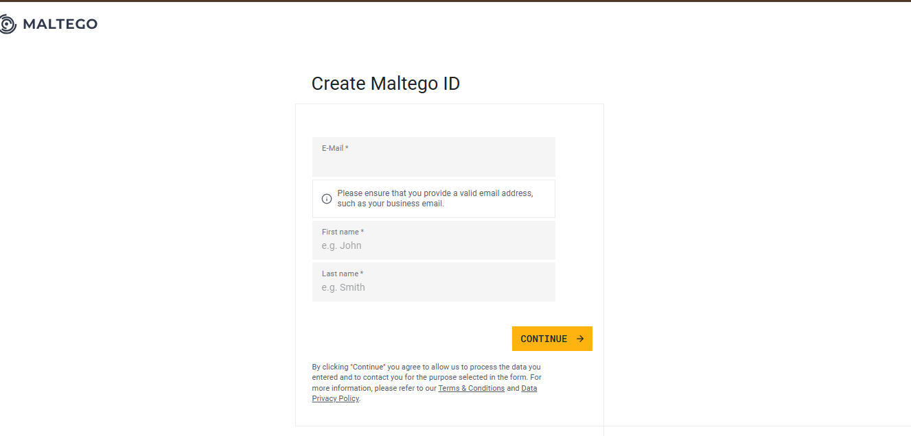
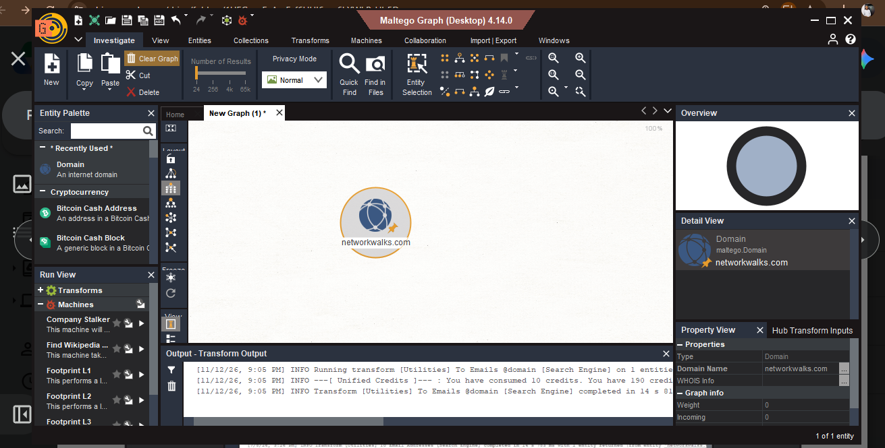
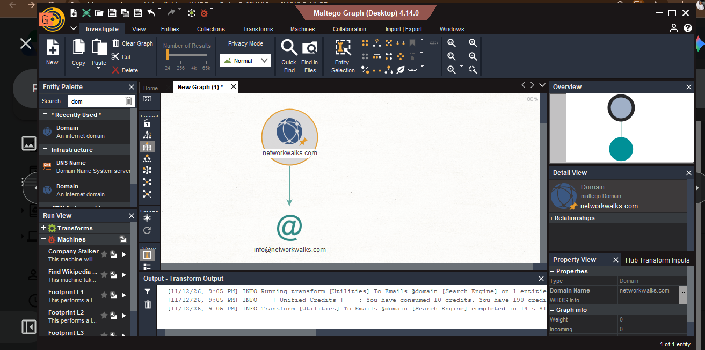

# W2-PM3: Maltego-Based Footprinting

## 1. Project Overview
This project explores the use of **Maltego** (Community Edition) for gathering, visualising, and analysing publicly available Open-Source Intelligence (OSINT) about an authorized target organization (`networkwalks.com`).

---

## 2. Objectives
- Understand Maltego and its core role in cybersecurity reconnaissance.
- Learn how to create, configure, and manage a Maltego investigation.
- Master the concepts of Entities and Transforms.
- Identify relationships between publicly available information (such as domains and corporate emails).
- Analyse and document reconnaissance findings.

---

## 3. Tools and Technologies
* **Primary Tool:** Maltego Community Edition (CE)
* **Operating System:** Windows / Kali Linux
* **Environment:** Active Internet Connection
* **Target Scope:** `networkwalks.com` (Authorized Educational Scope)

---

## 4. Practical Exercises

### 4.1 Installation and Configuration
1. **Download:** Visited [maltego.com](https://maltego.com) and downloaded the installation package.
2. **Setup:** Ran the Maltego setup wizard and completed standard local installation.
3. **Configuration:** Launched Maltego after installation, configured default system browser settings, and kept privacy mode on standard.
4. **Account Registration:** Selected **Maltego CE (Free)**, registered for a free Maltego ID/community account via the browser registration form, activated via email, and authenticated inside the application client.

---

### 4.2 Creating a Maltego Investigation
1. Opened the application menu, selected **New** (or created a New Graph via the top-left canvas shortcut icon) to open a blank investigation workspace.
2. Prepared the graph workspace to run incoming entity transforms.

---

### 4.3 Understanding Entities and Transforms
* **Entities:** Data objects on the canvas representing elements like Domains, People, Companies, Email Addresses, and IP addresses.
* **Transforms:** Automated API queries or search-engine scraping tools executed against an entity to discover related nodes and map digital footprints.

---

### 4.4 Performing Footprinting
1. Searched for the **"Domain"** entity type in the Entity Palette and dragged it onto the main graph canvas.
2. Double-clicked the target Entity and changed its value name to **`networkwalks.com`**.
3. Right-clicked the `networkwalks.com` entity node, filtered for **email-related transforms**, and executed the lookup to uncover associated corporate email addresses.

---

### 4.5 Results and Analysis
* **Primary Relationship Discovered:**
  ```text
  networkwalks.com ---> [Email Entity] ---> info@networkwalks.com
Analysis: The search engine and utility transform successfully correlated the target root domain with its primary publicly listed administrative contact vector (info@networkwalks.com). Visualizing this connection in Maltego highlights how external asset mapping exposes corporate contact points without direct target interaction.

5. Screenshots and Evidence
Plaintext
Screenshots/
├── maltego-installation.png
├── maltego-registration.png
├── maltego-domain.png
└── maltego-email-result.png


Maltego Installation:


Maltego Setup & Registration:




Target Domain Entity Added:




Email Transform Output Graph:




6. Challenges Encountered
Managing authentication redirection loops between the web browser registration portal and the local Maltego client desktop window.

Operating within Community Edition limits regarding transform response depth and query frequency quotas.

7. Lessons Learned
Graph-based reconnaissance tools like Maltego offer superior visualization of relationships (such as linking a corporate domain directly to exposed mailboxes) compared to raw command-line text logs.

Automated OSINT utilities can rapidly harvest public artifacts like info@networkwalks.com, which serves as a valuable vector for social engineering awareness or phishing simulation assessments.

8. Conclusion
The Maltego footprinting module successfully demonstrated how to initialize an OSINT workspace, build entity maps, and execute automated queries against networkwalks.com to isolate target email structures safely.

Security Disclaimer
All reconnaissance activities were conducted for education purposes only using authorized targets and publicly available information, in accordance with ethical cybersecurity practices.

: ## 👤 Author Metadata

* **Name:** Abiodun Omotosho
* **Program:** Networkwalks Cybersecurity Internship
* **Focus Areas:** Cybersecurity | Network Security | SOC Analyst | Penetration Tester
* **LinkedIn:** [Abiodun Omotosho Profile](https://www.linkedin.com/in/abiodunomotosho1)

This repository serves as a live record of my technical development, practical achievements, and professional growth in cybersecurity.
