# PENETRATION TESTING REPORT
### Footprinting & Network Scanning Phases
**W2-PM-FINAL | CYBERSECURITY | NETWORKWALKS**

| Field | Detail |
| :--- | :--- |
| **Pentester Name (Cybersecurity Professional)** | Abiodun Omotosho |
| **Program/Batch** | B084-Networkwalks |
| **Date** | 13 November 2026 |
| **Modules completed** | W2-PM1 (Footprinting with Multiple Kali Tools) W2-PM3 (Footprinting with Maltego) W2-PM4 (Footprinting with theHarvester) W2-PM5 (Network Scanning with Zenmap) |
| **Client/Target** | 1. Networkwalks (`networkwalks.com` — secured written permission, Ref: `NW-084-178`) 2. My own local LAN Network (`172.20.10.0/28`) |
| **Permission secured from client?** | Yes (Ref: `NW-084-178`, valid 13 Nov 2026 – 20 Nov 2026) |
| **Phases covered** | Phase 1: Reconnaissance & Footprinting Phase 2: Scanning & Network Discovery Phase 3–5: In Progress |

---

## 1. Liability Disclaimer
I have performed these activities only on the systems & devices where I had secured written permission (`NW-084-178`) or the devices/systems that I own myself. All these materials are for education and research purpose only. Do not use anything from here to break the law. The instructor, the authors and Networkwalks are not responsible for what you do with this knowledge. Every action you take is your own responsibility. Misuse can lead to criminal charges, heavy fines, loss of your job and a permanent record. In most countries unauthorised access is a crime even when nothing is damaged.

---

## 2. Introduction
This report covers passive and active footprinting of the `networkwalks.com` domain using multiple Kali Linux tools (`W2-PM1`), Maltego (`W2-PM3`), and theHarvester (`W2-PM4`), alongside scanning my own local area network with Zenmap (`W2-PM5`). Together, these four modules demonstrate how an attacker progresses from gathering publicly available intelligence and OSINT to mapping live hosts, open services, and hardware addresses on a local network. This forms the Week 2 deliverable of my ongoing cybersecurity internship program at Networkwalks (Batch B084).

All commands were executed in Kali Linux (footprinting and OSINT) and on a Windows PC (`Abbeylanre`) with Zenmap installed (network scanning). Every step below documents the tools used, the results observed, evidence collected, and the security implications from an attacker's perspective.

---

## 3. Tools Used
The table below lists each tool used across the four completed Week 2 modules and its purpose.

| Tool | Purpose |
| :--- | :--- |
| **Kali Linux & Windows** | Operating systems used for reconnaissance and network scanning activities |
| **WHOIS** | Find domain registration details (owner, registration dates, name servers) |
| **whatweb** | Fingerprint web technologies (web server, CMS, plugins, IP address) |
| **nslookup** | Resolve the domain name to its IPv4/IPv6 addresses using DNS |
| **curl -I** | Inspect HTTP response headers and exposed API endpoints |
| **wafw00f** | Detect whether a Web Application Firewall (WAF) protects the target site |
| **dnsrecon** | Enumerate DNS records (NS, MX, SPF, TXT, SRV) |
| **Maltego** | Perform visual link analysis and infrastructure relationship mapping (`W2-PM3`) |
| **theHarvester** | Harvest public emails, subdomains, hosts, and employee names from public sources (`W2-PM4`) |
| **Zenmap (Nmap GUI)** | Scan the local subnet to discover live hosts, IP addresses, open ports, and MAC addresses (`W2-PM5`) |
| **Windows CMD (`ipconfig /all`)** | Local host IPv4 address, subnet mask, gateway, and MAC address identification |

---

## 4. Activities Performed

### 4.1 Footprinting & Reconnaissance (W2-PM1, W2-PM3 & W2-PM4)
I performed reconnaissance against the `networkwalks.com` domain using six core Kali Linux CLI tools (`W2-PM1`) combined with OSINT and link-analysis frameworks (`W2-PM3` and `W2-PM4`):

* **WHOIS (`W2-PM1`):** Obtained publicly available domain registration information, registrar details, and authoritative name servers for `networkwalks.com`.
* **WhatWeb (`W2-PM1`):** Fingerprinted the web technology stack, identifying WordPress (`7.0.4`), WP Download Manager (`3.3.58`), and underlying server metadata.
* **Nslookup (`W2-PM1`):** Resolved `networkwalks.com` to its hosting IPv4 address (`192.232.216.135`).
* **Curl (`curl -I`, `W2-PM1`):** Inspected HTTP response headers, exposing server header details and the WordPress REST API endpoint (`/wp-json/`).
* **Wafw00f (`W2-PM1`):** Checked for Web Application Firewall protection, identifying **ModSecurity (SpiderLabs)**.
* **DNSRecon (`W2-PM1`):** Enumerated DNS infrastructure records, including Name Servers (NS), Mail Exchange (MX), SPF/TXT, and Service (SRV) records.
* **Maltego (`W2-PM3`):** Performed graphical link analysis using Maltego transforms to map domain relationships, DNS entities, netblocks, and associated infrastructure.
* **theHarvester (`W2-PM4`):** Executed passive OSINT queries against public data sources to enumerate subdomains, public email addresses, and host records linked to `networkwalks.com`.

### 4.2 Network Scanning with Zenmap (W2-PM5)
For the network scanning phase, I used **Zenmap (Nmap 7.993)** on my Windows PC (`Abbeylanre`) to perform host discovery on my local area network.

1. **Local Network Identification:** Using `ipconfig /all` in Windows Command Prompt, I identified my active wireless interface (`Intel(R) Dual Band Wireless-AC 8265`) configuration:
   * **Local Host IPv4 Address:** `172.20.10.3`
   * **Subnet Mask:** `255.255.255.240` (`/28`)
   * **Target LAN Subnet:** `172.20.10.0/28` (scanned across `172.20.10.0/24`)
   * **Default Gateway:** `172.20.10.1`
   * **Local Host MAC Address:** `E4-70-B8-81-BE-15`

2. **Host Discovery & Enumeration:** I entered the target network range into Zenmap and executed a discovery/port scan, which scanned 256 IP addresses in `108.61` seconds and identified **2 live hosts**:
   * **Host 1 (`172.20.10.1`):** Default Gateway / Router — MAC Address: `86:AD:8D:E8:5D:64` (Open TCP ports detected: `21/tcp` ftp, `53/tcp` domain, `49152/tcp` unknown).
   * **Host 2 (`172.20.10.3`):** Local Tester PC (`Abbeylanre`) — MAC Address: `E4-70-B8-81-BE-15` (Open TCP ports detected: `135/tcp` msrpc, `139/tcp` netbios-ssn, `445/tcp` microsoft-ds).

3. **Topology Export:** After completing the scan, I opened the **Topology** tab in Zenmap, enabled the map **Legend**, analyzed the hop distance and latency rings between my host and the gateway, and exported the network topology in **PDF format** (`subnet-topology.pdf`).

---

## 5. Risk Analysis / Impact
Based on the information collected during the footprinting and network scanning activities, I identified the following observations and potential risks:

| # | Risk / Finding | Evidence / Observation | Potential Impact | Risk Level |
| :--- | :--- | :--- | :--- | :--- |
| 1 | **Web technology information exposed** | WhatWeb identified WordPress (`7.0.4`) and WP Download Manager (`3.3.58`) | Attackers may use exposed CMS/plugin versions to search for known CVEs or outdated components | 🟠 Medium |
| 2 | **Server IP address identifiable** | Nslookup resolved `networkwalks.com` to `192.232.216.135` | Reveals the hosting infrastructure location and allows direct IP-level reconnaissance | 🟡 Low |
| 3 | **HTTP technical information exposed** | `curl -I` returned HTTP response headers and exposed `/wp-json/` | Assists attackers in technology fingerprinting and API endpoint enumeration | 🟡 Low |
| 4 | **WAF technology identifiable** | Wafw00f identified ModSecurity (SpiderLabs) | Reveals the defensive security layer in place, allowing attackers to tailor evasion attempts | 🟡 Low |
| 5 | **DNS & OSINT infrastructure exposed** | DNSRecon, Maltego, and theHarvester mapped DNS, MX, TXT, subdomains, and public contact records | Helps attackers build a comprehensive target profile for phishing or infrastructure mapping | 🟠 Medium |
| 6 | **Live hosts & open services on local LAN** | Zenmap identified 2 live hosts (`172.20.10.1` with ports 21, 53, 49152; `172.20.10.3` with SMB/RPC ports 135, 139, 445) | Exposed local services (such as FTP or SMB) could be targeted for lateral movement or unauthorized access if unpatched or misconfigured | 🟠 Medium |

> **Note:** The risks above are passive and active reconnaissance observations from the footprinting and scanning exercises, **not confirmed vulnerabilities**. No exploitation or vulnerability validation was performed as part of these modules. Further authorized vulnerability assessment and penetration testing would be required to confirm exploitability.

---

## 6. Recommendations
Based on the observations from these activities, I recommend the following security improvements:

1. **Review publicly exposed technology information:** Minimize version banners and metadata exposed by WordPress and installed plugins.
2. **Keep software updated:** Regularly patch WordPress core, plugins (such as WP Download Manager), and underlying server software against known security advisories.
3. **Harden HTTP response headers:** Configure web servers to suppress unnecessary technical headers and restrict public access to `/wp-json/` endpoints if not required.
4. **Audit DNS records and public OSINT footprint regularly:** Review DNS (TXT, SPF, SRV, MX) records, subdomains, and public email exposure to minimize the external attack surface.
5. **Maintain and tune WAF rules:** Keep ModSecurity enabled, updated with the latest OWASP Core Rule Set (CRS), and actively monitored.
6. **Restrict unnecessary local network services:** Disable unused services (such as plain-text FTP on port 21 or unnecessary SMB/NetBIOS exposure on ports 139/445) and enforce host-based firewall rules on local endpoints.
7. **Perform regular internal network discovery:** Periodically scan internal subnets to detect unauthorized or rogue devices and maintain accurate network topology documentation.
8. **Enforce strict authorization controls:** Ensure all reconnaissance and scanning activities are strictly governed by written authorization (`LOA`) and defined scope boundaries.

---

## 7. Conclusion
During Week 2 of my Cybersecurity & Ethical Hacking internship (Batch B084), I completed practical modules covering passive/active footprinting (`W2-PM1`, `W2-PM3`, `W2-PM4`) and local network scanning (`W2-PM5`).

In the footprinting modules, I learned how combining CLI tools (`WHOIS`, `WhatWeb`, `Nslookup`, `Curl`, `Wafw00f`, `DNSRecon`) with OSINT and link-analysis tools (`Maltego`, `theHarvester`) reveals a target's domain ownership, hosting IP, web stack, WAF defenses, subdomains, and DNS architecture without sending intrusive payloads.

In the Zenmap scanning module, I identified my local network configuration (`172.20.10.3` on subnet `172.20.10.0/28`), enumerated **2 active hosts** along with their MAC addresses and open TCP ports, and generated a visual PDF network topology map.

These exercises demonstrated how structured information gathering forms the foundation of any penetration test, why technical findings must be documented clearly with actionable risk ratings, and why strict adherence to written authorization (`NW-084-178`) is mandatory in professional cybersecurity engagements.

---

## 8. Evidences Collected
Screenshots and files collected as evidence during the activities (stored in the `screenshots/` folder):
### PDF Documents
* [Signed Letter of Authorization (NW-084-178)](./Screenshots/permission-letter.pdf)

### Screenshots

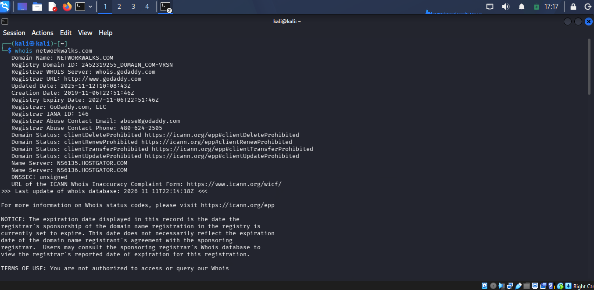

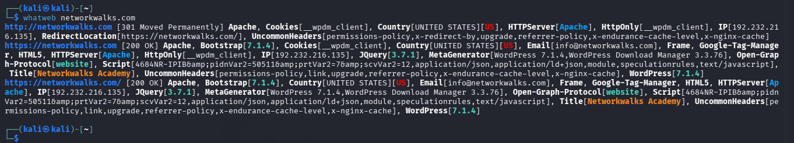

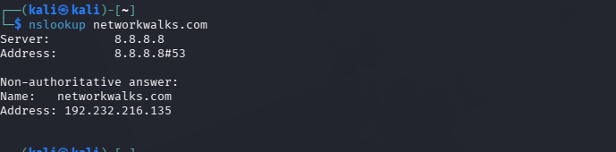

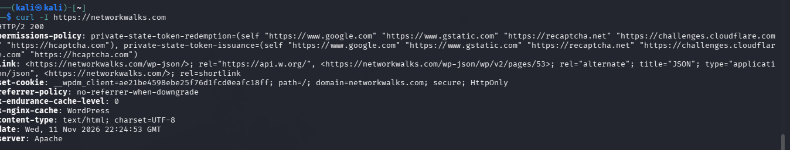

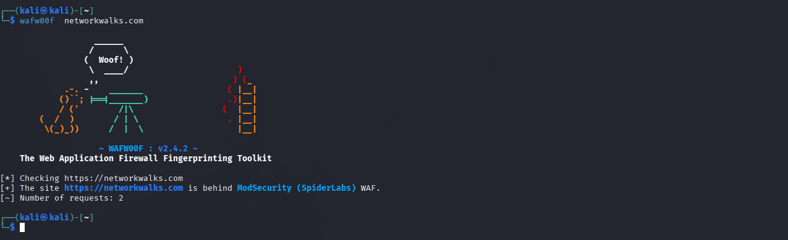

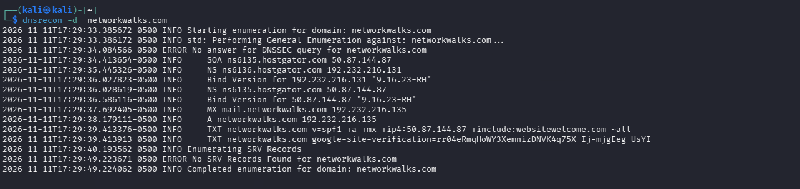

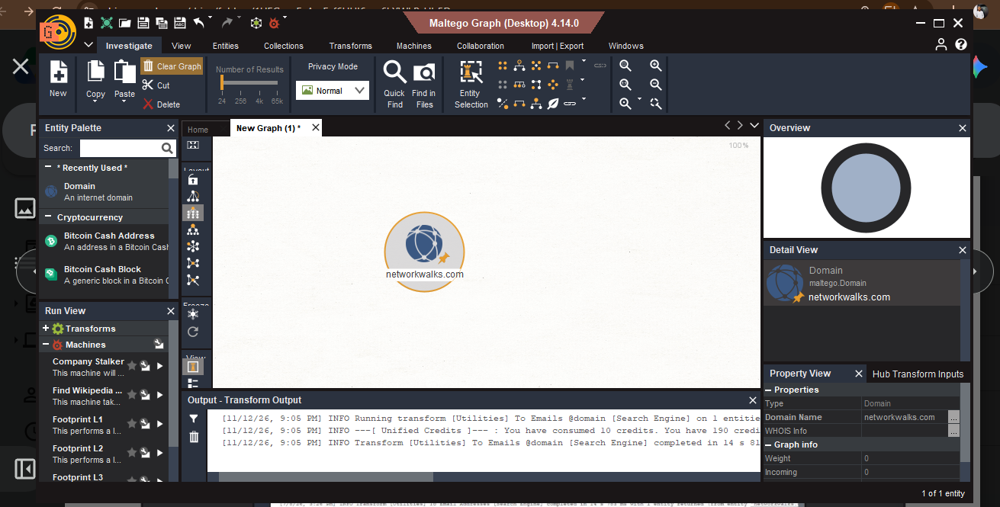

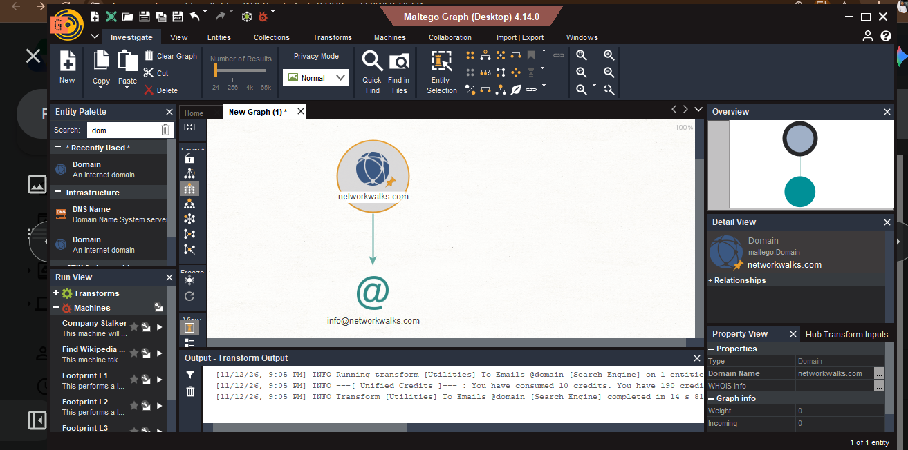

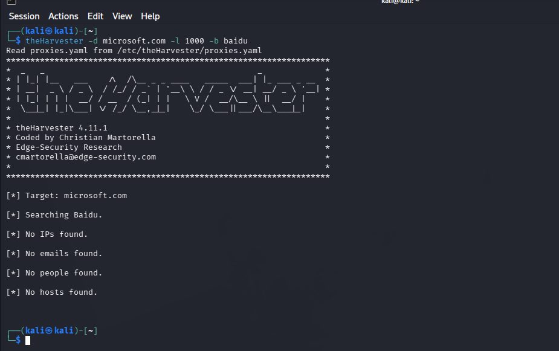

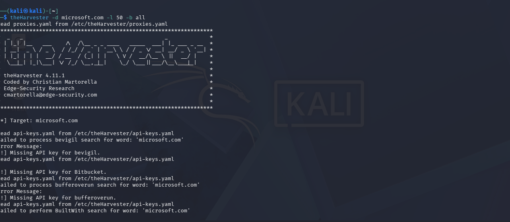

 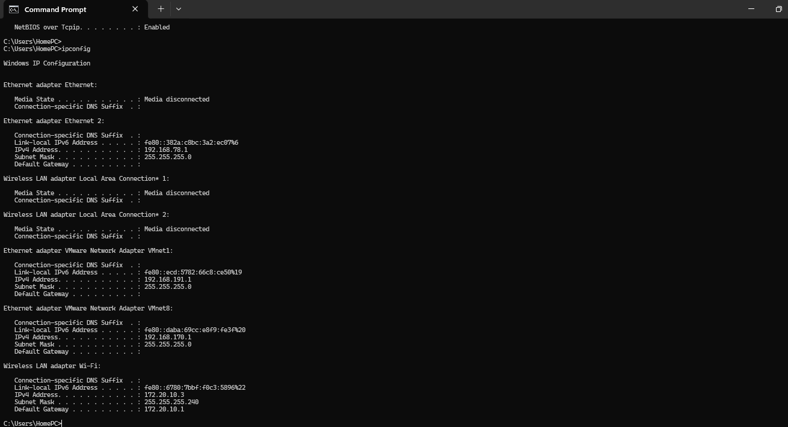
 
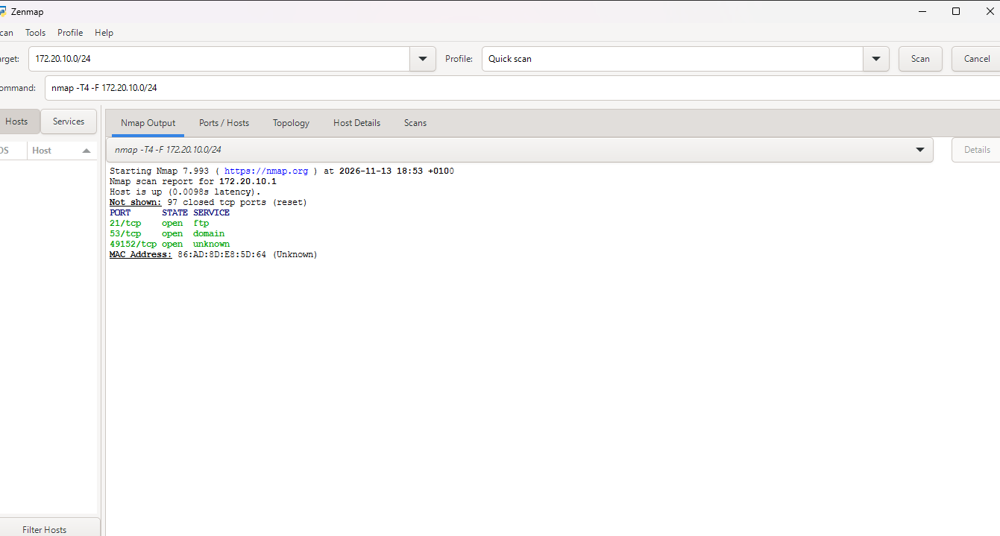

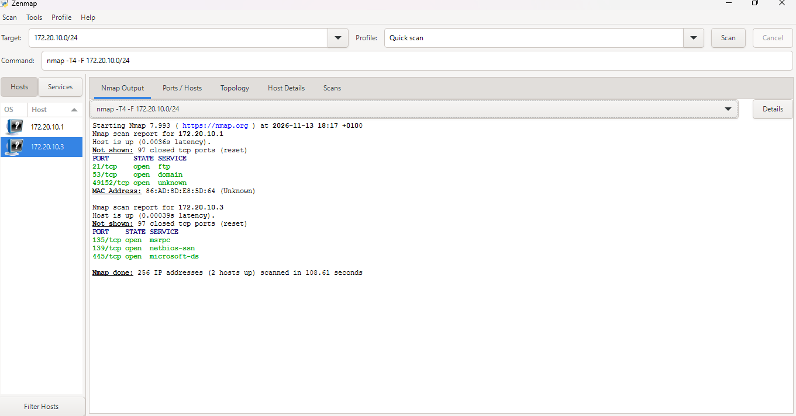

 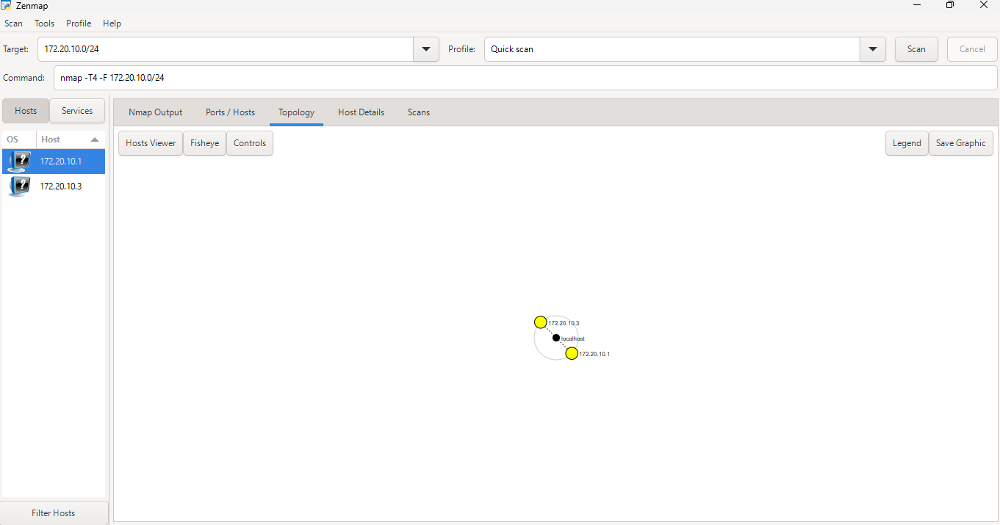

